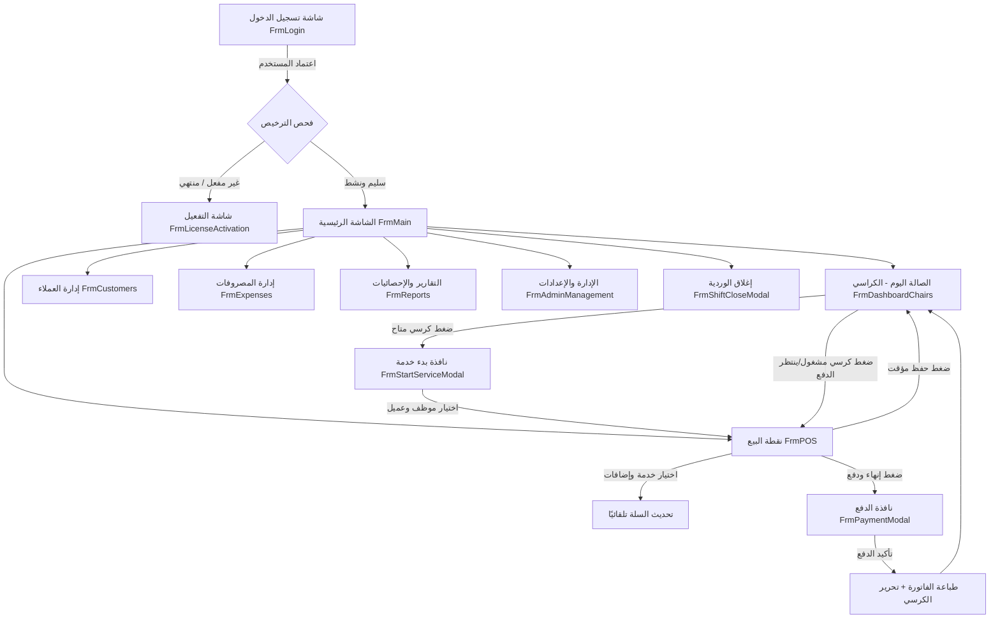

# خطة تنفيذ مشروع Simple Salon POS (VB.NET - WinForms - SQLite)

برنامج Desktop حديث ومستقر لإدارة صالونات الحلاقة والعناية (Simple Salon POS) مصمم ليعمل بسرعة فائقة، بواجهة عربية RTL، تجربة مستخدم تعتمد على البطاقات والأزرار الكبيرة (Touch Friendly)، وقاعدة بيانات SQLite محلية، ونظام ترخيص مخصص مشفر بالـ RSA.

---

## 1. فحص المواصفات وتحليل المتطلبات

### الأهداف الرئيسية
1. **السرعة والبساطة المطلقة**: تنفيذ الدورة التشغيلية الكاملة (اختيار كرسي ← اختيار موظف ← اختيار خدمات وإضافات ← دفع) في أقل من 3 خطوات بدون تعقيدات أنظمة ERP.
2. **تجربة مستخدم بصريّة متميزة**: Cards كبيرة، ألوان تعبر عن الحالات (متاح / مشغول / ينتظر الدفع)، أزرار ضخمة Touch-Friendly، وبدون DataGridView تقني أو إدخال IDs باللوحة في الشاشات الرئيسية.
3. **عدم فرض عميل إجباري**: دعم "عميل نقدي" (Walk-in) كخيار افتراضي.
4. **نظام الإضافات السريعة (Extras)**: زر Toggle بنقرة واحدة للإضافة والتنقيل السريع (غسيل +20، ماسك +30).
5. **نظام ترخيص مخصص وآمن (License Manager)**: توقيع رقمي باستخدام RSA SHA-256 لمنع التلاعب وتوليد رخص مرتبطة بالـ Machine ID من خلال برنامج منفصل `SalonLicenseGenerator`.

---

## 2. الهيكلية المقترحة (Architecture & Solution Structure)

المشروع سيتكون من حل برمجي (Solution) يتضمن مشروعين رئيسيين بـ **VB.NET**:

```text
D:\DEVELOPER\VPNET\SALON\
│
├── SalonPOS.sln
│
├── SalonPOS/                          ' التطبيق الرئيسي للصالون
│   ├── SalonPOS.vbproj
│   ├── ApplicationEvents.vb
│   │
│   ├── Models/                        ' كيانات البيانات الأساسية
│   │   ├── User.vb
│   │   ├── Employee.vb
│   │   ├── Chair.vb
│   │   ├── Customer.vb
│   │   ├── ServiceCategory.vb
│   │   ├── ServiceItem.vb
│   │   ├── ServiceExtra.vb
│   │   ├── ChairSession.vb
│   │   ├── ChairSessionItem.vb
│   │   ├── Sale.vb
│   │   ├── SaleItem.vb
│   │   ├── Expense.vb
│   │   ├── Shift.vb
│   │   └── LicenseData.vb
│   │
│   ├── DTOs/                          ' كائنات نقل البيانات وعروض POS
│   │   ├── CartItemDto.vb
│   │   ├── ChairStatusDto.vb
│   │   ├── DailySummaryDto.vb
│   │   └── EmployeeReportDto.vb
│   │
│   ├── Data/                          ' طبقة قاعدة البيانات
│   │   ├── DatabaseInitializer.vb     ' إنشاء الجداول والجداول الافتراضية SQLite
│   │   ├── DbConnectionFactory.vb     ' إدارة اتصال SQLite
│   │   └── Repositories/              ' تنفيذ الاستعلامات عبر ADO.NET / Dapper
│   │       ├── UserRepository.vb
│   │       ├── EmployeeRepository.vb
│   │       ├── ChairRepository.vb
│   │       ├── CustomerRepository.vb
│   │       ├── ServiceRepository.vb
│   │       ├── SessionRepository.vb
│   │       ├── SaleRepository.vb
│   │       ├── ExpenseRepository.vb
│   │       ├── ShiftRepository.vb
│   │       └── SettingRepository.vb
│   │
│   ├── Services/                      ' منطق العمل والتطبيق Business Logic
│   │   ├── AuthService.vb
│   │   ├── ChairService.vb
│   │   ├── PosService.vb
│   │   ├── ShiftService.vb
│   │   ├── ExpenseService.vb
│   │   ├── ReportService.vb
│   │   ├── BackupService.vb
│   │   └── AppLogger.vb
│   │
│   ├── Licensing/                     ' نظام التحقق من الترخيص
│   │   ├── MachineFingerprint.vb      ' استخراج بصمة الجهاز الفذة
│   │   ├── LicenseValidator.vb        ' التحقق من توقيع RSA وتاريخ الصلاحية
│   │   └── AppPublicKey.vb            ' المفتاح العام RSA المصرح به
│   │
│   ├── Printing/                      ' طباعة الفواتير الحرارية
│   │   ├── ReceiptPrinter.vb          ' طباعة 80mm / 58mm
│   │   └── ReceiptTemplate.vb
│   │
│   ├── Controls/                      ' عناصر التحكم المخصصة UI Components
│   │   ├── ChairCardControl.vb        ' كارت الكرسي تفاعلي
│   │   ├── ServiceCardControl.vb      ' كارت الخدمة في الـ POS
│   │   ├── ExtraToggleButton.vb       ' زر Toggle للإضافات
│   │   ├── CartRowControl.vb          ' سطر الفاتورة
│   │   ├── EmployeeCardControl.vb     ' كارت الموظف
│   │   └── CategoryTabButton.vb       ' تبويب الأقسام
│   │
│   ├── Forms/                         ' شاشات النظام
│   │   ├── FrmMain.vb                 ' الشاشة الرئيسية الحاضنة (RTL)
│   │   ├── FrmLogin.vb                ' تسجيل الدخول
│   │   ├── FrmDashboardChairs.vb      ' شاشة الصالة اليوم / الكراسي
│   │   ├── FrmStartServiceModal.vb    ' نافذة بدء خدمة (اختيار موظف وعميل)
│   │   ├── FrmPOS.vb                  ' شاشة كاشير نقطة البيع
│   │   ├── FrmPaymentModal.vb         ' نافذة الدفع واختيار طريقة السداد
│   │   ├── FrmQuickCustomerModal.vb   ' إضافة عميل سريع
│   │   ├── FrmCustomers.vb            ' إدارة العملاء
│   │   ├── FrmExpenses.vb             ' إدارة المصروفات
│   │   ├── FrmReports.vb              ' تقارير المبيعات والعمولات
│   │   ├── FrmShiftCloseModal.vb      ' إغلاق الوردية والحسابات
│   │   ├── FrmAdminManagement.vb      ' إدارة الموظفين، الكراسي، والخدمات
│   │   ├── FrmSettings.vb             ' إعدادات الصالون والطباعة والنسخ
│   │   └── FrmLicenseActivation.vb    ' شاشة التفعيل وتقديم السيريال
│   │
│   └── Helpers/                       ' أدوات مساعدة UI & Utilities
│       ├── UIStyleHelper.vb           ' الألوان والخطوط والحواف المستديرة
│       ├── ShortcutManager.vb         ' إدارة اختصارات الكيبورد F1..F9
│       └── CurrencyFormatter.vb
│
└── SalonLicenseGenerator/             ' تطبيق منفصل لإصدار التراخيص (خاص بالإدارة)
    ├── LicenseGeneratorForm.vb
    ├── RsaKeyManager.vb               ' مولّد مفاتيح RSA وتوقيع الترخيص
    └── LicensePayload.vb
```

---

## 3. مخطّط قاعدة البيانات (SQLite Database Schema)

سيتم استخدام SQLite3 محليًا بسلسلة اتصال خفيفة ومستقرة، مع تفعيل `PRAGMA foreign_keys = ON;`.

### الهيكل الداخلي للجداول:

```sql
-- 1. جدول المستخدمين
CREATE TABLE IF NOT EXISTS Users (
    Id INTEGER PRIMARY KEY AUTOINCREMENT,
    Username TEXT NOT NULL UNIQUE,
    PasswordHash TEXT NOT NULL,
    DisplayName TEXT NOT NULL,
    Role TEXT NOT NULL CHECK(Role IN ('ADMIN', 'CASHIER', 'EMPLOYEE')),
    IsActive INTEGER NOT NULL DEFAULT 1,
    CreatedAt TEXT NOT NULL
);

-- 2. جدول الموظفين (الفنيين/الحلاقين)
CREATE TABLE IF NOT EXISTS Employees (
    Id INTEGER PRIMARY KEY AUTOINCREMENT,
    Name TEXT NOT NULL,
    Phone TEXT NULL,
    CommissionRate REAL NOT NULL DEFAULT 0.0,
    IsActive INTEGER NOT NULL DEFAULT 1,
    CreatedAt TEXT NOT NULL
);

-- 3. جدول الكراسي
CREATE TABLE IF NOT EXISTS Chairs (
    Id INTEGER PRIMARY KEY AUTOINCREMENT,
    ChairNumber INTEGER NOT NULL,
    Name TEXT NOT NULL,
    DisplayOrder INTEGER NOT NULL DEFAULT 0,
    IsActive INTEGER NOT NULL DEFAULT 1
);

-- 4. جدول العملاء
CREATE TABLE IF NOT EXISTS Customers (
    Id INTEGER PRIMARY KEY AUTOINCREMENT,
    Name TEXT NOT NULL,
    Phone TEXT NULL UNIQUE,
    Notes TEXT NULL,
    CreatedAt TEXT NOT NULL
);

-- 5. أقسام الخدمات
CREATE TABLE IF NOT EXISTS ServiceCategories (
    Id INTEGER PRIMARY KEY AUTOINCREMENT,
    Name TEXT NOT NULL,
    IconName TEXT NULL,
    DisplayOrder INTEGER NOT NULL DEFAULT 0,
    IsActive INTEGER NOT NULL DEFAULT 1
);

-- 6. الخدمات
CREATE TABLE IF NOT EXISTS Services (
    Id INTEGER PRIMARY KEY AUTOINCREMENT,
    CategoryId INTEGER NOT NULL,
    Name TEXT NOT NULL,
    Price REAL NOT NULL,
    DurationMinutes INTEGER NOT NULL DEFAULT 30,
    IsActive INTEGER NOT NULL DEFAULT 1,
    FOREIGN KEY(CategoryId) REFERENCES ServiceCategories(Id)
);

-- 7. الإضافات على الخدمات
CREATE TABLE IF NOT EXISTS ServiceExtras (
    Id INTEGER PRIMARY KEY AUTOINCREMENT,
    ServiceId INTEGER NOT NULL,
    Name TEXT NOT NULL,
    Price REAL NOT NULL,
    IsActive INTEGER NOT NULL DEFAULT 1,
    FOREIGN KEY(ServiceId) REFERENCES Services(Id) ON DELETE CASCADE
);

-- 8. جلسات الكراسي المفتوحة (حالة الكرسي الحالية)
CREATE TABLE IF NOT EXISTS ChairSessions (
    Id INTEGER PRIMARY KEY AUTOINCREMENT,
    ChairId INTEGER NOT NULL,
    EmployeeId INTEGER NOT NULL,
    CustomerId INTEGER NULL,
    Status TEXT NOT NULL CHECK(Status IN ('IN_SERVICE', 'WAITING_PAYMENT')),
    StartedAt TEXT NOT NULL,
    TotalAmount REAL NOT NULL DEFAULT 0.0,
    FOREIGN KEY(ChairId) REFERENCES Chairs(Id),
    FOREIGN KEY(EmployeeId) REFERENCES Employees(Id),
    FOREIGN KEY(CustomerId) REFERENCES Customers(Id)
);

-- 9. تفاصيل عناصر الجلسة المفتوحة
CREATE TABLE IF NOT EXISTS ChairSessionItems (
    Id INTEGER PRIMARY KEY AUTOINCREMENT,
    SessionId INTEGER NOT NULL,
    ServiceId INTEGER NOT NULL,
    ServiceName TEXT NOT NULL,
    Price REAL NOT NULL,
    Quantity INTEGER NOT NULL DEFAULT 1,
    EmployeeId INTEGER NULL, -- إمكانية إسناد خدمة لموظف آخر إن وجد
    FOREIGN KEY(SessionId) REFERENCES ChairSessions(Id) ON DELETE CASCADE
);

-- 10. إضافات عناصر الجلسة
CREATE TABLE IF NOT EXISTS ChairSessionItemExtras (
    Id INTEGER PRIMARY KEY AUTOINCREMENT,
    SessionItemId INTEGER NOT NULL,
    ExtraId INTEGER NOT NULL,
    ExtraName TEXT NOT NULL,
    Price REAL NOT NULL,
    FOREIGN KEY(SessionItemId) REFERENCES ChairSessionItems(Id) ON DELETE CASCADE
);

-- 11. جدول الورديات (Shifts)
CREATE TABLE IF NOT EXISTS Shifts (
    Id INTEGER PRIMARY KEY AUTOINCREMENT,
    UserId INTEGER NOT NULL,
    StartedAt TEXT NOT NULL,
    EndedAt TEXT NULL,
    OpeningCash REAL NOT NULL DEFAULT 0.0,
    CashSales REAL NOT NULL DEFAULT 0.0,
    CardSales REAL NOT NULL DEFAULT 0.0,
    TransferSales REAL NOT NULL DEFAULT 0.0,
    TotalExpenses REAL NOT NULL DEFAULT 0.0,
    ExpectedCash REAL NOT NULL DEFAULT 0.0,
    ActualCash REAL NULL,
    Variance REAL NULL,
    Status TEXT NOT NULL CHECK(Status IN ('OPEN', 'CLOSED')),
    FOREIGN KEY(UserId) REFERENCES Users(Id)
);

-- 12. مبيعات الفواتير المحفوظة (Sales)
CREATE TABLE IF NOT EXISTS Sales (
    Id INTEGER PRIMARY KEY AUTOINCREMENT,
    InvoiceNumber TEXT NOT NULL UNIQUE,
    SessionId INTEGER NULL,
    ChairId INTEGER NOT NULL,
    EmployeeId INTEGER NOT NULL,
    CustomerId INTEGER NULL,
    SubTotal REAL NOT NULL,
    Discount REAL NOT NULL DEFAULT 0.0,
    TotalAmount REAL NOT NULL,
    PaymentMethod TEXT NOT NULL CHECK(PaymentMethod IN ('CASH', 'CARD', 'TRANSFER', 'SPLIT')),
    CashReceived REAL NOT NULL DEFAULT 0.0,
    ChangeAmount REAL NOT NULL DEFAULT 0.0,
    ShiftId INTEGER NOT NULL,
    CreatedByUserId INTEGER NOT NULL,
    CreatedAt TEXT NOT NULL,
    FOREIGN KEY(ShiftId) REFERENCES Shifts(Id),
    FOREIGN KEY(ChairId) REFERENCES Chairs(Id),
    FOREIGN KEY(EmployeeId) REFERENCES Employees(Id)
);

-- 13. تفاصيل بنود الفاتورة المبيعة
CREATE TABLE IF NOT EXISTS SaleItems (
    Id INTEGER PRIMARY KEY AUTOINCREMENT,
    SaleId INTEGER NOT NULL,
    ServiceId INTEGER NOT NULL,
    ServiceName TEXT NOT NULL,
    Price REAL NOT NULL,
    Quantity INTEGER NOT NULL,
    SubTotal REAL NOT NULL,
    EmployeeId INTEGER NOT NULL,
    EmployeeCommissionAmount REAL NOT NULL DEFAULT 0.0,
    FOREIGN KEY(SaleId) REFERENCES Sales(Id) ON DELETE CASCADE
);

-- 14. إضافات بنود الفاتورة المبيعة
CREATE TABLE IF NOT EXISTS SaleItemExtras (
    Id INTEGER PRIMARY KEY AUTOINCREMENT,
    SaleItemId INTEGER NOT NULL,
    ExtraId INTEGER NOT NULL,
    ExtraName TEXT NOT NULL,
    Price REAL NOT NULL,
    FOREIGN KEY(SaleItemId) REFERENCES SaleItems(Id) ON DELETE CASCADE
);

-- 15. المصروفات
CREATE TABLE IF NOT EXISTS Expenses (
    Id INTEGER PRIMARY KEY AUTOINCREMENT,
    Amount REAL NOT NULL,
    Category TEXT NOT NULL,
    Notes TEXT NULL,
    ShiftId INTEGER NOT NULL,
    CreatedByUserId INTEGER NOT NULL,
    CreatedAt TEXT NOT NULL,
    FOREIGN KEY(ShiftId) REFERENCES Shifts(Id)
);

-- 16. إعدادات النظام
CREATE TABLE IF NOT EXISTS Settings (
    Key TEXT PRIMARY KEY,
    Value TEXT NOT NULL
);

-- 17. معلومات الترخيص التفعيل
CREATE TABLE IF NOT EXISTS LicenseInfo (
    Id INTEGER PRIMARY KEY AUTOINCREMENT,
    LicenseKey TEXT NOT NULL,
    CustomerName TEXT NOT NULL,
    MachineId TEXT NOT NULL,
    ExpiryDate TEXT NOT NULL,
    ActivatedAt TEXT NOT NULL
);
```

---

## 4. خريطة التنقل والتفاعل (Navigation Map)



---

## 5. نماذج الواجهات (Wireframes)

### Wireframe 1: الشاشة الرئيسية (الصالة اليوم / الكراسي)

```text
+---------------------------------------------------------------------------------------------+
| [شعار الصالون]  صالون الأناقة | 19/08/2026 14:30 | المستخدم: كاشير1 | [وردية مفتوحة #12]   |
+---------------------------------------------------------------------------------------------+
| (الرئيسية/الكراسي)  (نقطة البيع F1)  (العملاء F2)  (المصروفات F3)  (التقارير F4)  (إغلاق الوردية) |
+---------------------------------------------------------------------------------------------+
|                                                                                             |
|  ملخص اليوم:  [المبيعات: 3,850 ج.م]  [العملاء: 24]  [الخدمات: 39]  [المصروفات: 450]  [الصافي: 3,400]|
|---------------------------------------------------------------------------------------------|
|  الكراسي (6 متاح | 2 مشغول)                                                                |
|                                                                                             |
|  +------------------+  +------------------+  +------------------+  +------------------+  |
|  |  كرسي 1          |  |  كرسي 2          |  |  كرسي 3          |  |  كرسي 4          |  |
|  |  [ متاح ]        |  |  [ مشغول ]       |  |  [ ينتظر الدفع ] |  |  [ متاح ]        |  |
|  |                  |  |  الموظف: محمد     |  |  الموظف: أحمد     |  |                  |  |
|  |  انقر لبدء خدمة  |  |  الخدمات: قص شعر |  |  العميل: عميل نقدي|  |  انقر لبدء خدمة  |  |
|  |                  |  |  المدة: 20 دقيقة |  |  الإجمالي: 170ج.م|  |                  |  |
|  +------------------+  +------------------+  +------------------+  +------------------+  |
|                                                                                             |
|  +------------------+  +------------------+  +------------------+  +------------------+  |
|  |  كرسي 5          |  |  كرسي 6          |  |  كرسي 7          |  |  كرسي 8          |  |
|  |  [ متاح ]        |  |  [ متاح ]        |  |  [ متاح ]        |  |  [ متاح ]        |  |
|  +------------------+  +------------------+  +------------------+  +------------------+  |
+---------------------------------------------------------------------------------------------+
```

---

### Wireframe 2: نافذة بدء خدمة صغيرة (Modal)

```text
+-------------------------------------------------------------+
|                       بدء خدمة - كرسي 1                    |
+-------------------------------------------------------------+
| اختر الموظف:                                                |
|  +------------------+  +------------------+                 |
|  |  (كارت) محمد     |  |  (كارت) أحمد     |                 |
|  +------------------+  +------------------+                 |
|  +------------------+  +------------------+                 |
|  |  (كارت) محمود    |  |  (كارت) مصطفى    |                 |
|  +------------------+  +------------------+                 |
|-------------------------------------------------------------|
| اختيار العميل (اختياري):                                     |
|  [ (*) عميل نقدي (Walk-in) ]  [ ( ) اختيار عميل ] [ + عميل جديد ]|
|-------------------------------------------------------------|
|                        [ بدء الخدمة وفك POS ]                |
+-------------------------------------------------------------+
```

---

### Wireframe 3: شاشة نقطة البيع (POS Screen)

```text
+---------------------------------------------------------------------------------------------+
| [← العودة للكراسي] | الكرسي: كرسي 3 | الموظف: محمد | العميل: عميل نقدي                       |
+---------------------------------------------------------------------------------------------+
| (الجانب الأكبر: الأقسام والخدمات)            | (الجانب الأيسر: الطلب الحالي / الفاتورة)     |
| [ بحث عن خدمة...                       ]    | +-----------------------------------------+ |
|                                             | | الخدمة / الإضافة            السعر   تحكم | |
| [ الكل ] [ شعر ] [ ذقن ] [ عناية ] [ أخرى ] | |-----------------------------------------| |
|                                             | | قص شعر                      100   [+] [-]| |
| +--------------+ +--------------+           | |   └ غسيل                     20   [X]  | |
| | قص شعر       | | تدريج         |           | | حلاقة ذقن                   50   [+] [-]| |
| | 100 ج.م      | | 120 ج.م      |           | +-----------------------------------------+ |
| +--------------+ +--------------+           | | الإضافات المتاحة للخدمة المحددة:         | |
| +--------------+ +--------------+           | | [ + غسيل 20 ]  [ + ماسك 30 ]           | |
| | صبغة شعر     | | استشوار      |           | |-----------------------------------------| |
| | 150 ج.م      | | 50 ج.م       |           | | الإجمالي: 170 جنيه مصري                 | |
| +--------------+ +--------------+           | |                                         | |
|                                             | | [   حفظ مؤقت   ]   [  إنهاء ودفع (F9)  ] | |
+---------------------------------------------------------------------------------------------+
```

---

### Wireframe 4: نافذة الدفع (Payment Modal)

```text
+-------------------------------------------------------------+
|                        إتمام وتأكيد الدفع                   |
+-------------------------------------------------------------+
|  المبلغ الإجمالي المطلوب:                                    |
|                      170.00 جنيه                            |
|-------------------------------------------------------------|
|  طريقة الدفع:                                                |
|  [ (*) نقدي ]    [ ( ) بطاقة ]    [ ( ) تحويل ]    [ ( ) مختلط ]|
|-------------------------------------------------------------|
|  المبلغ المستلم من العميل:                                  |
|  [ 200     ]  جنيه                                          |
|                                                             |
|  الباقي للعميل:                                              |
|  30.00 جنيه                                                 |
|-------------------------------------------------------------|
| [ [X] طباعة الفاتورة تلقائيًا ]                              |
|                                                             |
|                   [  تأكيد الدفع وإغلاق (F9)  ]               |
+-------------------------------------------------------------+
```

---

## 6. الكلاسات والخدمات (Classes & Services Architecture)

### Repositories (ADO.NET Direct with SQLite parameters):
- `ChairRepository`: استعلام وتحديث حالة الكراسي والجلسات المفتوحة.
- `ServiceRepository`: جلب الخدمات، الأقسام، والإضافات.
- `SessionRepository`: إنشاء/تعديل/حفظ جلسة الكرسي وسلتها الحالية.
- `SaleRepository`: تسجيل عملية البيع النهائية وحفظ الفاتورة وبنودها.
- `EmployeeRepository`: إدارة الفنيين ونسب العمولات.
- `ShiftRepository`: جلب الوردية المفتوحة، فتح/إغلاق الوردية وحساب الفروقات.
- `ExpenseRepository`: إضافة واستعلام المصروفات اليومية.

### Services:
- `PosService`: يدير سيناريوهات السلة، إضافة الخدمات والإضافات، وحساب الإجمالي، وإغلاق الجلسة وتحويلها إلى مبيعات.
- `LicenseValidator`: يتحقق من ملف الترخيص بفك التوقيع الرقمي ومقارنة `MachineId` وتاريخ الانتهاء.
- `MachineFingerprint`: توليد معرف الجهاز باستخدام Motherboard Serial + CPU ID المجمعة مع SHA256.
- `ReceiptPrinter`: إرسال أامر ESC/POS المباشرة أو استخدام `PrintDocument` للطباعة السريعة على الطابعات الحرارية (80mm/58mm).

---

## 7. سيناريوهات ومسارات عمل نقطة البيع (POS Workflows)

### Scenario A (السيناريو الأساسي الكامل):
1. يفتح الكاشير البرنامج ← يظهر dashboard بـ 8 كراسي (كل كارت يعرض "متاح").
2. يضغط الكاشير على `كرسي 3`.
3. تفتح نافذة صغيرة "بدء خدمة" ← يضغط كارت `محمد` (الموظف)، والعميل مفعل افتراضيًا على `عميل نقدي`.
4. يتغير حالة `كرسي 3` إلى `IN_SERVICE` وتفتح شاشة POS مباشرة.
5. يضغط زر `قص شعر 100` ← تضاف الفاتورة مباشرة.
6. تحت الخدمة تظهر أزرار الإضافات Toggle ← يضغط `غسيل +20` (يتحول الزر للون الأخضر وتضاف الـ 20 لسعر الفاتورة).
7. يصبح الإجمالي 120 ج.م.
8. يضغط الكاشير `إنهاء ودفع`.
9. تفتح نافذة الدفع الإجمالي 120 ج.م ← يدخل المستلم 150 ← يحسب الباقي 30 تلقائيًا.
10. يضغط `تأكيد الدفع` ← تحفظ الفاتورة رقم `#INV-1001` ← يطبع الريسيت ← يعود الكرسي 3 إلى حالة `AVAILABLE` فورًا.

### Scenario B (إضافة خدمة أثناء الجلسة):
1. يضغط الكاشير على `كرسي 5` (حالتها حاليًا `IN_SERVICE`).
2. تفتح شاشة POS محملة بالخدمات السابقة المفتوحة للكرسي.
3. يضغط خدمة `ماسك 30` ← تضاف مباشرة إلى السلة المفتوحة بدون إنشاء فاتورة جديدة.
4. يضغط `حفظ مؤقت` ← تعود الشاشة إلى الصالة وتظل الكرسي في حالة `IN_SERVICE` بالإجمالي الجديد.

### Scenario C (خدمات متعددة دفعة واحدة):
1. عند بدء جلسة، يضغط الكاشير متتالياً: `قص شعر` ثم `حلاقة ذقن` ثم `تنظيف بشرة`.
2. تدرج العناصر الثلاثة في السلة مباشرة في نفس العملية بدون نوافذ تأكيد أو تنقل بين شاشات.

### Scenario D (تغيير موظف لخدمة معينة):
1. الموظف الافتراضي للكرسي هو `محمد`.
2. إذا قام `مصطفى` بتقديم خدمة `تنظيف بشرة` داخل نفس الكرسي، يوجد زر صغير `تغيير الموظف` بجانب السطر في السلة لتحديد `مصطفى` لهذه الخدمة فقط لحساب عمولته بدقة.

---

## 8. هكتيك ونظام الترخيص (Licensing Architecture)

### 1. توليد بصمة الجهاز (Machine Fingerprint):
تجميع قيم ثابتة ومستقرة:
- Motherboard Serial Number
- Processor ID
- System Drive Volume Serial Number
تدمج وتؤخذ لها قيمة SHA256 وترمز بالشكل: `SALON-XXXX-XXXX-XXXX`.

### 2. التوقيع الرقمي (RSA SHA-256):
- مشروع `SalonLicenseGenerator` يحتفظ بـ **Private Key** سرية (RSA 2048-bit).
- يحتوي تطبيق `SalonPOS` على الـ **Public Key** فقط.
- تحتوي بيانات الترخيص (JSON Payload) على:
  - `CustomerName`
  - `ProductName`
  - `MachineId`
  - `ActivationDate`
  - `ExpiryDate`
  - `IsLifetime`
  - `MaxDevices`
- يتم توقيع الـ JSON Payload بالـ Private Key وتحويل الناتج إلى Base64 `LicenseKey`.

### 3. التحقق داخل تطبيق الصالون:
عند بدء التشغيل:
1. يقرأ التطبيق الترخيص المخزن في SQLite.
2. يتم التحقق من التوقيع باستعمال الـ Public Key.
3. يتم مقارنة `MachineId` مع الجهاز الحالي.
4. يتم التأكد أن تاريخ اليوم `<= ExpiryDate`.
5. إذا فشل أي شرط، تفتح شاشة `FrmLicenseActivation` للتفعيل، ولا تتأثر البيانات السابقة إطلاقًا.

---

## 9. خطة التنفيذ المرحلية (Phase-by-Phase Plan)

### Phase 1 — Foundation & Database Setup
- [x] إنشاء الهيكل الرئيسي للحل (`SalonPOS.sln` والمشروعين).
- [x] إعداد قاعدة بيانات SQLite والـ DDL الكامل للجداول والبيانات الأولوية.
- [x] إنشاء كلاس الاتصال `DbConnectionFactory` ومساعدات `Dapper/ADO.NET`.
- [x] إعداد نظام التوقيع RSA وبصمة الجهاز `MachineFingerprint`.

### Phase 2 — Core UI Design & Controls
- [x] إعداد الثيم البصري والـ Custom Controls:
  - `ChairCardControl` (مع دعم الحالات والألوان).
  - `ServiceCardControl` و `ExtraToggleButton`.
  - `CartRowControl` ودعم RTL الشامل.

### Phase 3 — POS & Session Workflow
- [x] شاشة الكراسي الرئيسية `FrmDashboardChairs`.
- [x] نافذة بدء خدمة السريعة `FrmStartServiceModal`.
- [x] شاشة POS التفاعلية السريعة `FrmPOS`.
- [x] نافذة الدفع وإغلاق الجلسات `FrmPaymentModal`.

### Phase 4 — Management & Operations
- [x] إدارة الموظفين، الكراسي، الخدمات والأقسام والإضافات.
- [x] إدارة المصروفات والعملاء.
- [x] إدارة الورديات (فتح/إغلاق الوردية والعهد).

### Phase 5 — Reports, Printing & Backup
- [x] تقارير المبيعات اليومية، عوائد الخدمات، وعمولات الموظفين.
- [x] خدمة الطباعة الحرارية للريسيتات.
- [x] محرك النسخ الاحتياطي التلقائي (Daily Automatic Backup).

### Phase 6 — License Manager App & Hardening
- [x] بناء تطبيق `SalonLicenseGenerator` المستقل.
- [x] اختبار شامل لجميع سيناريوهات العمل والترخيص والأخطاء.

---

## 10. خطة التحقق والاختبار (Verification Plan)

### Automated / Diagnostic Tests:
1. **Database Schema Verification**: التأكد من إنشاء جميع الجداول والعلاقات وتغذيها بالبيانات الأساسية.
2. **License Signature Verification**: اختبار توقيع رخصة في `SalonLicenseGenerator` والتحقق من قبولها في `SalonPOS` ورفض أي مفتاح مزور أو منتهي أو مخصص لجهاز آخر.

### Manual POS Flow Verification:
1. تنفيذ سيناريو A الكامل (اختيار كرسي ← موظف ← خدمات وإضافات ← دفع كاش ← تحرير كرسي).
2. اختبار إضافة خدمة وتعديلها أثناء الجلسة (سيناريو B).
3. اختبار دفع الفاتورة بطرق سداد مختلفة (نقدي / بطاقة / تحويل).
4. اختبار إغلاق الوردية ومطابقة النقدية المتبقية بالأرباح والمصروفات.
5. اختبار أداء الواجهة وسرعة التفاعل عند الضغط على الكروت والأزرار الكبيرة.
